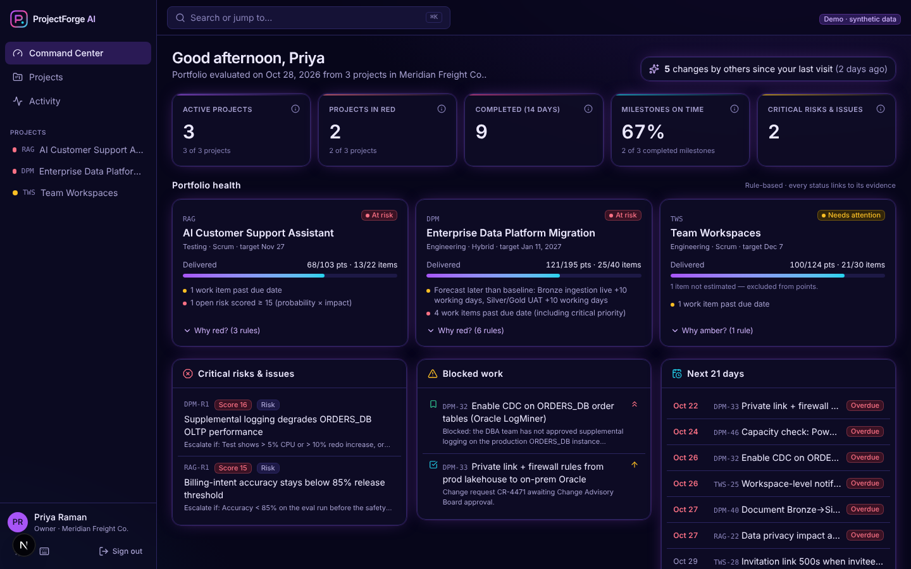
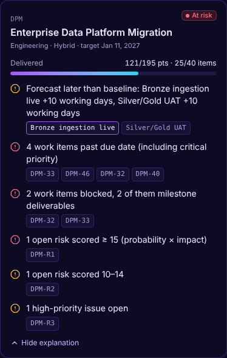
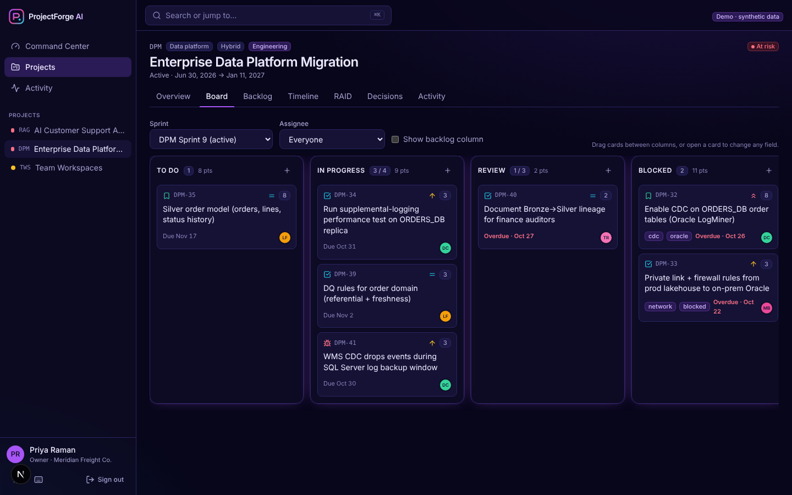
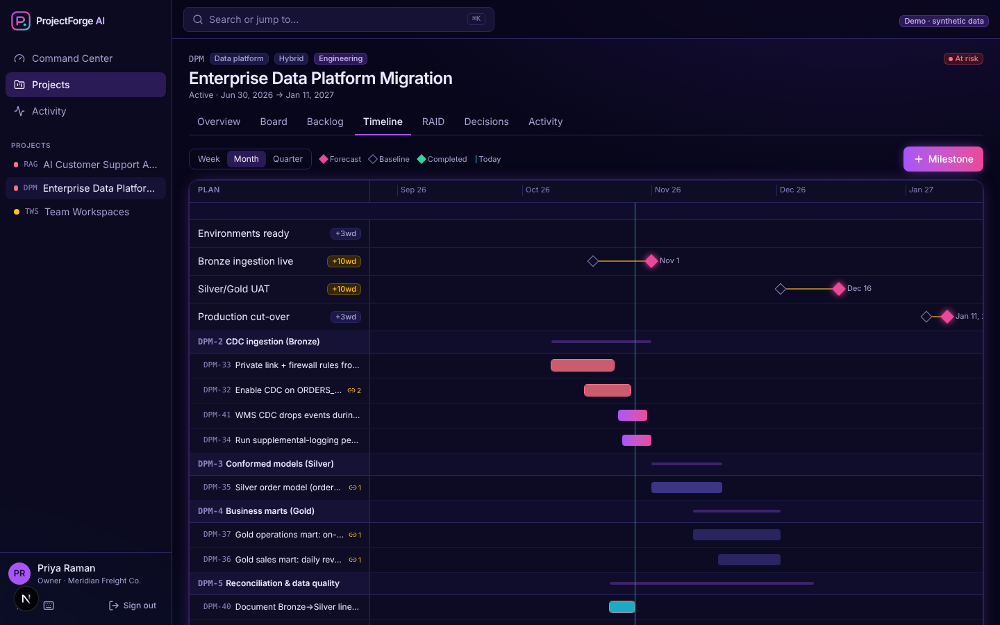
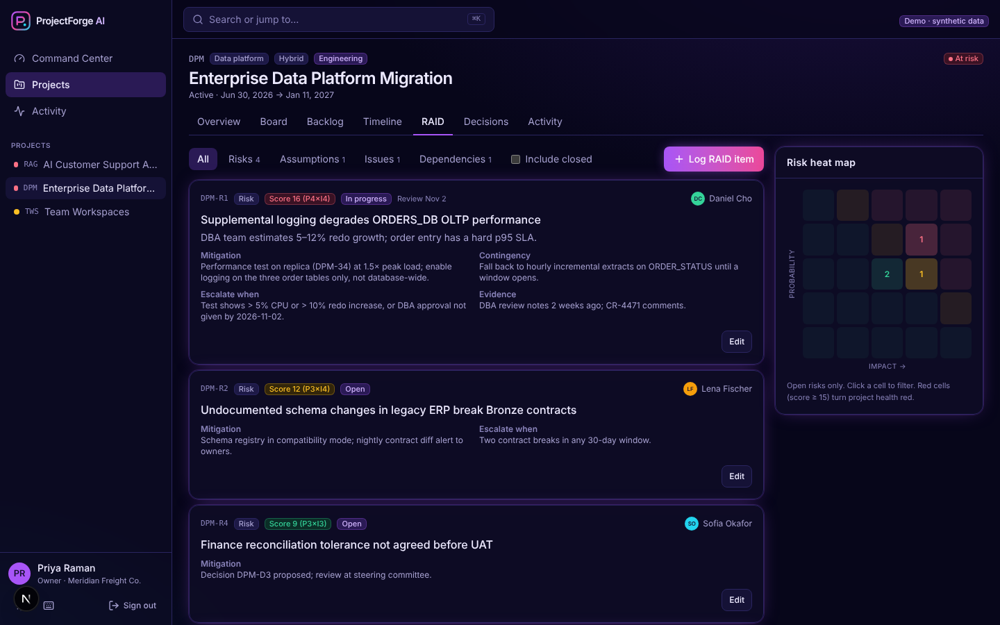
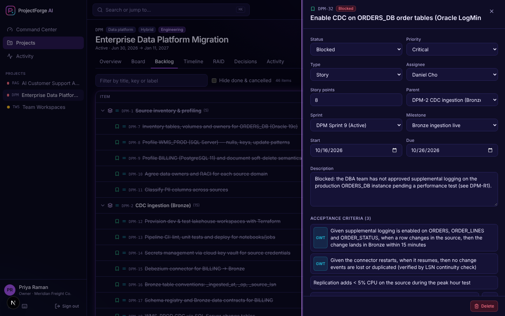
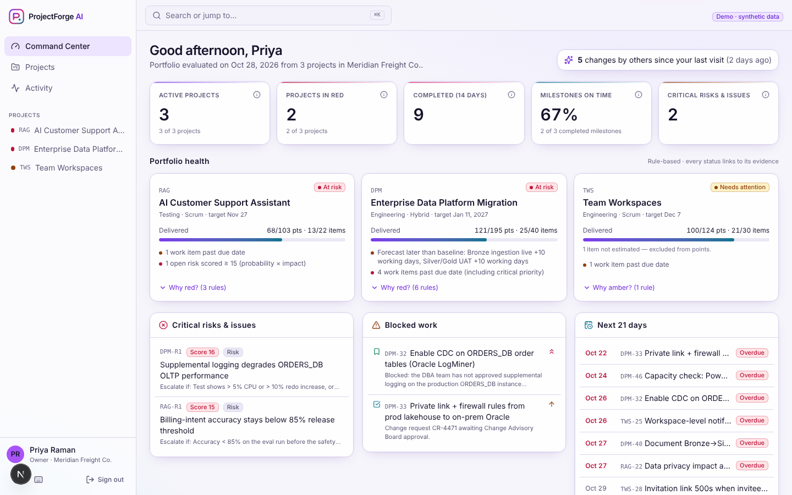
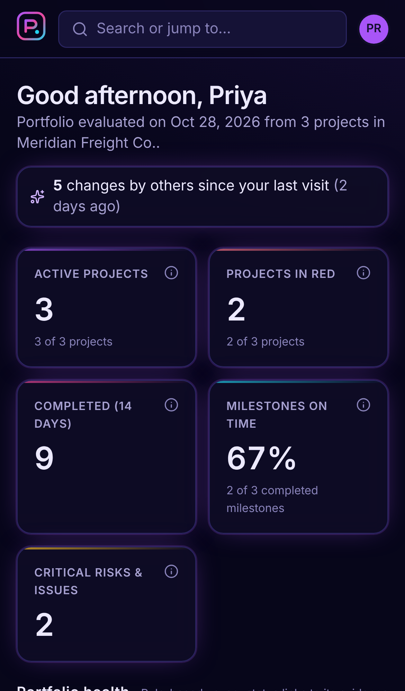

# ProjectForge AI

**An AI-native project management operating system for technical delivery** — portfolio health you
can trace to records, dependency-aware plans, RAID and decision logs, and (on the roadmap) governed AI
agents that prepare the work while humans approve it.



> **Status: Phase 1 of 6 complete.** The project-management foundation is implemented, tested and
> runnable. The AI copilot and multi-agent orchestration are designed (see
> [Architecture](docs/ARCHITECTURE.md)) but **not built yet** — nothing in the current app calls an
> LLM. See [what works today](#what-works-today) vs. [roadmap](#roadmap).

---

## Why this exists

PM tools are systems of record: they store what people type. The expensive work — noticing that a
slipped CDC feed now threatens a launch, turning meeting notes into stories, writing the Friday
report, checking every acceptance criterion has a test before go/no-go — is still manual.

ProjectForge AI is built on three principles:

1. **Never fabricate status.** Every red/amber/green is the output of explicit rules over stored
   records and links to the records that triggered it. KPIs show their definitions and denominators.
2. **Deterministic first.** Health, variance, dependencies (and later critical path, capacity,
   forecasts) are computed in plain, tested code. LLMs will *explain and draft*, not compute facts.
3. **Human approval for consequence.** Agents will act through the same authorization checks as
   users, and write actions will only execute from an approval record.

The strongest fit is **technical programs** — data platform migrations and AI products — where
dependencies and governance gates are dense and generic tools are weakest.

## What works today

| Area | Implemented (Phase 1) |
|---|---|
| **Accounts & tenancy** | Email/password (argon2id), opaque server-side sessions in httpOnly cookies, multi-organization membership, org switching. Cross-tenant access returns 404 on every resource (tested). |
| **Roles** | viewer / member / admin / owner enforced on every endpoint (tested); UI becomes read-only for viewers. |
| **Projects** | Manual creation or from 4 templates (SaaS feature, cloud data migration, AI/RAG product, phase-gated); lifecycle phase, methodology, WIP limits. |
| **Work hierarchy** | Initiative → Epic → Feature → Story/Task/Bug → Subtask with hierarchy validation, per-project keys (`DPM-42`), acceptance criteria (plain or Given/When/Then), labels. |
| **Dependencies** | `blocks` / `relates_to` / `duplicates`, cross-project within an org; cycles rejected with the offending path. |
| **Milestones** | Baseline vs. forecast vs. actual, working-day variance, explicit audited re-baselining with a reason, deliverable counts. |
| **Sprints** | Sprints with capacity; committed vs. done points. |
| **RAID & decisions** | Risks (P×I score), assumptions, issues, dependencies with mitigation, contingency, escalation trigger, evidence, related items; heat map. Decision log with context, rationale, alternatives, who/when, supersession. |
| **Explainable health** | 9 rules (overdue / slipped milestones, overdue / blocked work, high risks, critical issues, stale data) → signals with evidence links. |
| **Command Center** | KPI tiles, portfolio health cards with "Why red?", critical risks, blocked work, 21-day deadlines, pending decisions, recent activity, changes since your last visit. |
| **Views** | Kanban (drag-and-drop, WIP warnings), backlog tree, Gantt-style timeline (baseline vs. forecast, today line, dependency counts), RAID, decisions, activity. |
| **Audit & search** | Append-only audit log for every mutation (who, what changed, when) driving history and activity feeds; Postgres full-text search + exact key lookup (`DPM-R1`). |
| **UX** | Command palette (⌘K / Ctrl K), keyboard shortcuts, dark/light themes, responsive layout with mobile bottom navigation, WCAG AA contrast checked by axe. |
| **Demo data** | Three synthetic projects with history (below) and a second tenant for isolation demos. |

### Screens

| | |
|---|---|
|  **Every status explains itself** |  **Board with WIP limits** |
|  **Baseline vs. forecast timeline** |  **RAID register with heat map** |
|  **Work item: AC, dependencies, history** |  **Light theme** |



All screenshots are of the running application with the synthetic demo dataset.

## Demo projects (synthetic)

All organizations, people, systems and figures are fictional.

- **DPM — Enterprise Data Platform Migration** (*Meridian Freight Co.*): Oracle / SQL Server /
  PostgreSQL sources → CDC into Bronze → Silver → Gold → Power BI. Order CDC is blocked on a DBA
  approval and a stuck firewall change; Bronze and UAT milestones have slipped 10 working days. Health: **red**, with the evidence.
- **RAG — AI Customer Support Assistant**: hybrid retrieval, golden eval set, red-teaming, PII
  redaction, latency budget; billing-intent accuracy (78.4%) is below the 85% release threshold.
- **TWS — Team Workspaces**: a SaaS feature over six Scrum sprints with velocity history, bugs and a
  spillover.
- **CTP — Clinical Trials Portal** (*Orbital Health Labs*): a separate tenant used to show that
  Meridian users can never see it.

## Architecture

```
Browser ──► Next.js (UI only) ──/api/* same-origin──► FastAPI modular monolith ──► PostgreSQL 16 (+pgvector)
                                                     auth · RBAC · tenancy · domain · health engine · audit
```

A modular monolith was chosen over a full-stack TypeScript app and over microservices; the
trade-offs are in [`docs/ARCHITECTURE.md`](docs/ARCHITECTURE.md) and the ADRs in
[`docs/DECISIONS.md`](docs/DECISIONS.md). PostgreSQL is the only stateful dependency (no Redis, no
paid vector DB, no Kubernetes).

- Backend: Python 3.12+, FastAPI, SQLAlchemy 2, Alembic, Pydantic 2, argon2-cffi
- Frontend: Next.js 16, React 19, TypeScript, Tailwind CSS 4, TanStack Query; API types generated from OpenAPI
- Tests: pytest against real PostgreSQL; Playwright + axe-core

## Getting started

### Option A — Docker Compose

```bash
docker compose up --build
# open http://localhost:3000 and pick a demo persona
```

The backend container runs migrations and loads the demo dataset on start (`SEED_DEMO=true`).
*Note: the Compose files are written but have not yet been run end-to-end (see
[Known limitations](docs/KNOWN_LIMITATIONS.md)); Option B is verified.*

### Option B — run natively (verified)

Prerequisites: PostgreSQL 16, Python 3.12+ with [uv](https://docs.astral.sh/uv/), Node 22.

```bash
# 1. Database
createuser projectforge --createdb -P        # password: projectforge (local only)
createdb -O projectforge projectforge
createdb -O projectforge projectforge_test   # for the test suite

# 2. Backend
cd backend
cp .env.example .env
uv sync
uv run alembic upgrade head
uv run python -m app.seed                    # synthetic demo data
uv run uvicorn app.main:app --reload --port 8000

# 3. Frontend (new terminal)
cd frontend
npm install
npm run dev                                  # http://localhost:3000
```

Demo users can sign in with one click on the login page, or with email + password
`projectforge-demo` (e.g. `priya@demo.projectforge.dev`). Demo mode is controlled by `DEMO_MODE`
and must be disabled for any deployment holding real data.

API docs (OpenAPI/Swagger): <http://localhost:8000/api/docs>

## Testing

```bash
cd backend && uv run ruff check . && uv run mypy app && uv run pytest    # 52 tests, real PostgreSQL
cd frontend && npm run lint && npm run typecheck && npm run build
cd frontend && npx playwright test                                       # 11 browser tests (starts servers if needed)
```

The pytest harness refuses to run unless the database name ends in `_test`, because it resets the
schema. Results and what is *not* yet tested: [`docs/TEST_RESULTS.md`](docs/TEST_RESULTS.md).

## Roadmap

| Phase | Scope | Status |
|---|---|---|
| 0 | Product & architecture, ADRs, data model | ✅ |
| 1 | PM foundation (this release) | ✅ |
| 2 | AI copilot: provider abstraction (Anthropic/OpenAI/Demo), usage & cost ledger, project-aware chat with citations, meeting notes → reviewed stories, grounded weekly report, document search | ⬜ next |
| 3 | Multi-agent orchestration: Chief PM planner, deterministic + LLM specialists, Postgres task queue, approvals, budgets, traces, Agent Control Center | ⬜ |
| 4 | Delivery intelligence: critical path & slip impact, sprint realism (Monte Carlo), release readiness, data-engineering & AI-evaluation toolkits | ⬜ |
| 5 | Integrations & automation: GitHub (real) + mock Jira, webhooks, automation engine, notifications | ⬜ |
| 6 | Portfolio polish, security hardening, deploy guide | ⬜ |

Detail: [`docs/IMPLEMENTATION_PLAN.md`](docs/IMPLEMENTATION_PLAN.md) · [`docs/BACKLOG.md`](docs/BACKLOG.md) ·
[`docs/PRODUCT_VISION.md`](docs/PRODUCT_VISION.md) (includes 14 ranked additional capabilities).

## Repository map

```
backend/    FastAPI app (app/), Alembic migrations, pytest suite, demo seed
frontend/   Next.js app (src/), Playwright e2e (e2e/)
docs/       vision, architecture, ADRs, plan, backlog, progress, test results, limitations, operations
```

## Development narrative

The product direction, scope priorities and domain model (technical program management, data
platform delivery, AI governance) come from my own background as a technical product manager. The
implementation was built with AI-assisted development (Claude Code) working from a detailed product
brief: architectural choices are recorded with their trade-offs in the ADRs, every phase is
committed incrementally, and test results in this repository are from actual runs — nothing is
claimed as working without an executed test.

## Documentation

[Architecture](docs/ARCHITECTURE.md) · [Decisions](docs/DECISIONS.md) · [Progress](docs/PROGRESS.md) ·
[Test results](docs/TEST_RESULTS.md) · [Known limitations](docs/KNOWN_LIMITATIONS.md) ·
[Operations](docs/OPERATIONS.md) · [Demo walkthrough](docs/DEMO_SCRIPT.md) · [Security](SECURITY.md) ·
[Contributing](CONTRIBUTING.md) · [Changelog](CHANGELOG.md)

## License

[MIT](LICENSE) — permissive, standard for portfolio projects, and keeps commercial options open.
