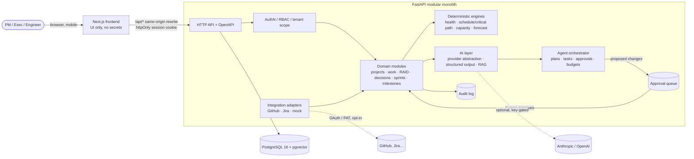
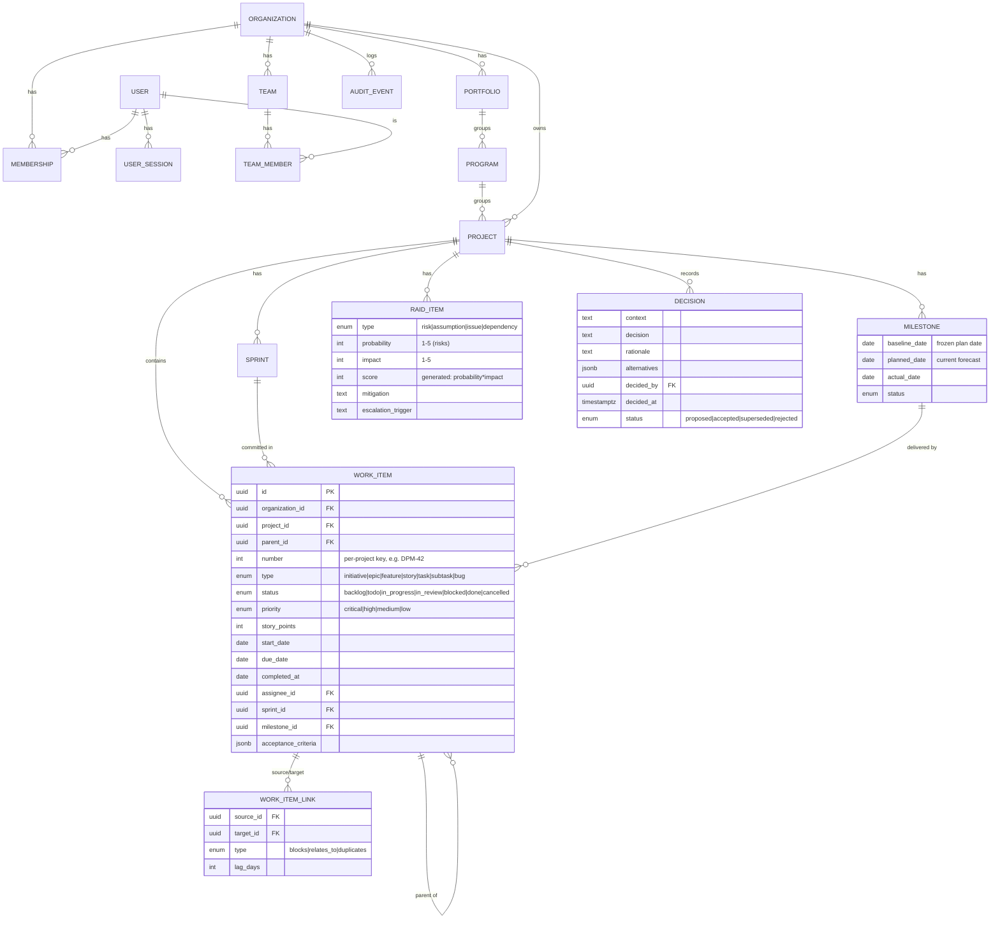
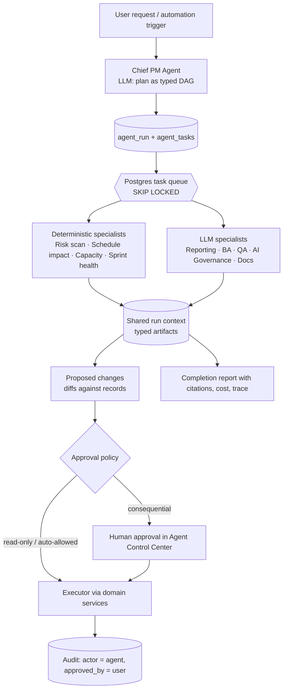

# ProjectForge AI — Architecture

Status legend used across docs: **[built]** implemented and tested in this repo ·
**[partial]** implemented with known gaps · **[planned]** designed, not built.

## 1. Three candidate architectures

| | A. Full-stack TypeScript monolith | B. Next.js UI + Python (FastAPI) modular monolith **← chosen** | C. Service-oriented (API gateway, agent workers, queue, vector DB) |
|---|---|---|---|
| Shape | Next.js route handlers + server actions, Prisma/Drizzle, TS agents | Next.js (UI only) → FastAPI (domain, AI, agents) → PostgreSQL (+pgvector) | Separate services for core API, agent runtime, ingestion, integrations; Redis/Kafka; managed vector DB |
| Solo-dev velocity | Highest: one language, one deployable | High: two deployables, typed contract via OpenAPI | Low: infrastructure dominates feature work |
| AI / data ecosystem | Adequate (SDKs exist), weaker for numeric/scheduling/eval tooling | Strongest: Pydantic structured output, eval/numeric libs, both vendor SDKs first-class | Strong, but each capability pays a network + ops tax |
| Deterministic engines (critical path, Monte Carlo forecast, capacity) | Fine | Natural fit (Python, easily unit-tested) | Fine, but split across services |
| Long-running agent work | Awkward in serverless route handlers | Background worker in same codebase, Postgres-backed task queue | Native (queue + workers) |
| Operating cost for a demo | Lowest | Low: 1 small VM or 2 free-tier services + Postgres | High |
| Portfolio signal | "Good web dev" | "Product + platform + AI engineering" with clean boundaries | "Over-engineered for an MVP" unless traffic justifies it |
| Main risk | AI/agent logic entangled with UI framework churn | Contract drift between UI and API (mitigated by OpenAPI-generated types) | Never reaching a working end-to-end product |

### Recommendation

**B — a modular monolith in Python/FastAPI with a separate Next.js frontend.**

- It keeps every domain rule (tenancy, RBAC, health scoring, scheduling, agent
  policy) in one process and one test suite, which is what makes "AI must not
  act without approval" *provable* rather than aspirational.
- The only extra moving part over option A is the frontend/backend split, and
  it's paid back because the API becomes the single surface that the UI, agents,
  automations and future integrations (including MCP) all use, under the same
  authorization checks.
- PostgreSQL does the job of queue (`SELECT … FOR UPDATE SKIP LOCKED`), full-text
  search (`tsvector`), vector search (pgvector), and the audit log. No Redis, no
  Kubernetes, no paid vector DB is required for the MVP (ADR-0003).

Option C's ideas (dedicated agent workers, queues) are preserved as *module
boundaries* so they can be split out later if load ever demands it.

## 2. System context



## 3. Backend module layout

```
backend/app/
  main.py            app factory, middleware, router registration
  config.py          pydantic-settings; all config from env
  db.py              engine/session; one transaction per request
  core/
    security.py      password hashing (argon2), session tokens (hashed at rest)
    deps.py          request context: current user, active org, role checks
    audit.py         append-only audit writer (called inside the same transaction)
    errors.py        typed error responses
  models/            SQLAlchemy 2.x ORM (one file per bounded context)
  schemas/           Pydantic request/response models (the OpenAPI contract)
  api/               routers: auth, orgs, projects, work_items, raid, decisions,
                     milestones, sprints, dashboard, search, activity
  services/          domain logic that is not CRUD:
                     health.py (explainable signals), schedule.py (CPM, impact) …
  seed/              synthetic demo organization + 3 demo projects
alembic/             migrations (the only way the schema changes)
tests/               pytest against a real PostgreSQL database
```

Rules:

1. **Routers are thin.** They parse, authorize, call a service or do simple CRUD,
   and return a schema. Business rules live in `services/`.
2. **Every tenant-scoped query is filtered by `organization_id`** obtained from the
   authenticated membership, never from the request body (§6).
3. **Every mutation writes an audit event in the same transaction.** If the audit
   write fails, the mutation rolls back.
4. **Deterministic first.** Anything computable (health, critical path, capacity,
   velocity, overdue detection) is plain code with unit tests. LLMs are used to
   *explain*, *draft* and *extract*, never to compute a number shown as fact.

## 4. Data model

PostgreSQL is the system of record. UUID primary keys (generated app-side),
`created_at/updated_at` on everything, `deleted_at` soft-delete on user-authored
records, `organization_id` denormalized onto every tenant-scoped table so that
tenant filtering is a single indexed predicate and future Row-Level Security
policies are trivial.

### 4.1 Phase 1 entities [built]



### 4.2 Later-phase entities [planned]

Documents & versions (+ chunks with `tsvector` and `vector` columns), meetings &
extracted actions, baselines, resources/allocations/budgets, tests/defects/
releases/release gates, AI evaluations, integration accounts & external sync
mappings, agent definitions, agent runs, agent tasks, tool calls, approval
requests, automations & automation runs, notifications. Each lands with its own
Alembic migration in the phase that uses it (see `IMPLEMENTATION_PLAN.md`), so
the schema never contains tables no code exercises.

### 4.3 Indexing strategy

- `(organization_id, …)` composite indexes lead every tenant-scoped table.
- `work_items (project_id, status)`, `(project_id, sprint_id)`, `(parent_id)`,
  `(assignee_id)`, unique `(project_id, number)`.
- `work_item_links` unique `(source_id, target_id, type)` + index on `target_id`
  for reverse traversal.
- Partial indexes `WHERE deleted_at IS NULL` on hot list queries.
- `audit_events (organization_id, created_at DESC)` and `(entity_type, entity_id)`.
- Full-text: generated `tsvector` columns with GIN indexes on work items, RAID,
  decisions (global search). [built for work items, RAID, decisions, projects]

### 4.4 Integrity, audit, retention

- Foreign keys everywhere; `ON DELETE CASCADE` only for pure child rows (links,
  memberships, sessions); everything user-authored is soft-deleted.
- `CHECK` constraints for enum-like ranges (probability/impact 1–5, points ≥ 0,
  no self-links).
- Dependency cycles are rejected in the service layer (graph check before insert).
- `audit_events` is append-only: actor (user or agent), action, entity, a JSON
  diff of changed fields, request id. It is the source for the activity feed and
  "what changed since my last login".
- Retention: sessions purged 30 days after expiry; audit events retained
  indefinitely by default (configurable later); soft-deleted records hard-deleted
  after 90 days by a maintenance job [planned].
- Backup/restore: see `docs/OPERATIONS.md`.

## 5. Authentication and sessions [built]

- Email + password (argon2id). Opaque random session token in an `httpOnly`,
  `SameSite=Lax` cookie; only its SHA-256 hash is stored. Sessions are revocable
  (logout deletes the row) and expire (default 7 days).
- The frontend calls `/api/*` on its own origin; Next.js rewrites to the backend,
  so no CORS and no token in JavaScript.
- State-changing requests require a custom header (`X-Requested-With`) as a CSRF
  defence in depth on top of `SameSite=Lax`.
- **Demo mode** (`DEMO_MODE=true`): the login page offers one-click sign-in as
  seeded synthetic users. Disabled by default outside local/dev.
- Login is rate-limited per IP+email (in-process token bucket; adequate for a
  single instance, documented limitation).

## 6. Authorization and tenancy [built]

- A user can belong to many organizations through `memberships(role)`.
  The active organization is selected per request via `X-Org-Id` (defaults to the
  user's first membership). The backend verifies membership on every request.
- Roles (ordered): `viewer < member < admin < owner`.

  | Capability | viewer | member | admin | owner |
  |---|:-:|:-:|:-:|:-:|
  | Read projects, work, RAID, decisions, dashboards | ✓ | ✓ | ✓ | ✓ |
  | Create/edit work items, RAID, decisions, links | | ✓ | ✓ | ✓ |
  | Create/archive projects, milestones, sprints | | ✓ | ✓ | ✓ |
  | Delete (soft) projects | | | ✓ | ✓ |
  | Manage members & org settings | | | ✓ | ✓ |
  | Approve agent write actions [planned] | | ✓* | ✓ | ✓ |

  \* subject to per-project approval policy.
- Cross-tenant access returns **404**, not 403, so IDs cannot be probed.
- Tenant isolation is enforced in application code and covered by tests; adding
  PostgreSQL Row-Level Security as a second layer is on the backlog (ADR-0004).

## 7. Explainable health [built]

Project health is **not** a score invented by a model. `services/health.py`
evaluates explicit rules over stored data and returns *signals*, each with a
severity, a human sentence, and the IDs of the records that triggered it:

- overdue milestone (planned date passed, not completed) → red
- milestone slipped vs baseline by > 5 working days → amber / > 10 → red
- overdue work items (due date passed, not done) → amber (red if ≥ 3 or critical)
- blocked work items → amber (red if any blocks a milestone deliverable)
- open risk with score ≥ 15 → red; ≥ 10 → amber
- open issue with priority critical → red
- no recorded activity for 14 days on an active project → amber ("stale data")

Overall status = worst signal; `green` only when no signals fire. Progress is
shown as `done points / total points` (and counts) with the denominator visible;
if items lack estimates, the UI says so instead of guessing.

## 8. AI layer [planned — Phase 2]

- `LLMProvider` protocol with `AnthropicProvider`, `OpenAIProvider`, and
  `DemoProvider` (deterministic, clearly labelled prerecorded/synthetic output).
  Selected by env; absent keys ⇒ demo provider, and the UI shows a "Demo AI" badge.
- All model output is parsed into Pydantic schemas; invalid output is retried
  once with the validation error, then surfaced as a failure (never silently
  "fixed").
- Every call logs model, tokens in/out, cost estimate, latency, purpose, and the
  agent run it belongs to. Per-org and per-run budgets are enforced *before* a call.
- Retrieval: hybrid — PostgreSQL full-text (`ts_rank`) + pgvector cosine when an
  embedding provider is configured — merged with reciprocal-rank fusion, always
  filtered by `organization_id` and project permissions *in SQL* before ranking.
- Every generated statement carries a provenance class: `source_fact`,
  `user_assumption`, `ai_interpretation`, `recommendation` (requires approval).
- Prompt-injection posture: retrieved/imported text is wrapped as data, tools
  available to a run are an allow-list derived from the user's role, and no tool
  that writes is executable without an approval record.

## 9. Multi-agent orchestration [planned — Phase 3]



Key decisions (ADR-0005): agents are **configurations** (role prompt, allowed
tools, output schema, model tier, budget) executed by one runtime — not 12 LLM
calls per request. Specialists that are pure computation never call an LLM.
Agents act only through the same domain services and authorization checks as
users; write tools produce *proposals*, and only an approval executes them.

## 10. Integrations [planned — Phase 5]

`IntegrationAdapter` interface (`authorize`, `list_remote`, `pull_changes`,
`push_change`, `verify_webhook`) with `MockGitHubAdapter`/`MockJiraAdapter` for
local demos and a real `GitHubAdapter` (fine-grained PAT or GitHub App) first.
External IDs map through `external_sync_mappings` (unique per provider+remote id)
which gives idempotency and duplicate prevention; webhook deliveries are
deduplicated by delivery id; polling is the fallback. No integration shows as
connected unless a credential was validated against the remote API.

## 11. Frontend [built — Phase 1 scope]

Next.js (App Router) + React 19 + TypeScript + Tailwind CSS v4. TanStack Query
for server state. No component kit dependency: a small in-repo set of accessible
primitives (button, dialog, menu, tabs, badge, table) keeps the visual language
distinctive and the bundle small. Dark ("Nebula") and light themes via CSS
variables; command palette (⌘K / Ctrl+K); keyboard shortcuts (`g d`, `g p`, `/`).
Mobile: responsive layouts, bottom navigation on small screens.

## 12. Deployment

- Local: `docker compose up` (postgres w/ pgvector, backend, frontend) or run
  natively (documented in README).
- Demo hosting [planned]: single small VM with Compose, or backend + frontend on
  free tiers with a managed Postgres. Nothing is deployed without the owner's
  explicit go-ahead.
